# SupplyChain Orchestrator

> An explainable, human-in-the-loop AI assistant for supply chain disruption risk and recovery planning.
> **All data is synthetic.** This is a portfolio prototype, not a production system.

When a supplier ships late, the hard question is not "is it late?" but "will we actually run out, which orders break, and what should we do?" This project answers that with a clear division of labour:

| Part | Who does it | Why |
|---|---|---|
| **Numbers** (stock cover, stock-out date, at-risk orders, costs, option ranking) | Deterministic Python engines | Same input gives the same output, and every number can be checked |
| **Words** (the briefing a planner reads) | An LLM (Gemini) | It only explains figures the engines produced. It never calculates |
| **Decisions** (approve / reject) | A human | The system never executes anything. Decisions are written to an audit log |

## What you see

Pick a disruption event, click **Run analysis**, and get:

- **Impact:** stock coverage vs. the delay, stock-out date, the production and customer orders at risk, and the money exposed
- **Recovery options:** use stock, transfer between warehouses, expedite, or switch to an alternate supplier, each checked for feasibility, costed and ranked
- **Impact chain:** the supplier-to-part-to-product-to-customer path from a graph database
- **Evidence:** contract clauses and policies retrieved from a document index
- **AI explanation:** a written briefing that cites that evidence
- **Decision:** approve or reject with a required name and rationale, recorded in an audit log
- **Document Library:** upload your own supplier contracts, policies, or runbooks (PDF, DOCX, TXT) — indexed immediately and used by the AI in future analyses

Two scenarios ship with the data:

| Event | Situation | Expected result |
|---|---|---|
| `EVT-001` | A shipment of PRT-104 is 4 days late | Late but **no shortage**: stock lasts about 13 days and the shipment lands first. Use stock |
| `EVT-002` | A shipment of PRT-112 is 14 days late | **Real shortage** from about Nov 3. One production order and one customer order ($10,750) at risk. Alternate supplier recommended |

## Architecture

```mermaid
flowchart LR
    UI[Streamlit UI] -->|HTTP| API[FastAPI]
    API --> AG[LangGraph agent]
    AG --> T1[Impact tool]
    AG --> T2[Planning tool]
    AG --> T3[Graph tool]
    AG --> T4[Retrieval tool]
    AG --> LLM[Gemini: explanation only]
    T1 --> PG[(PostgreSQL)]
    T2 --> PG
    T3 --> NEO[(Neo4j)]
    T4 --> CH[(ChromaDB)]
    API -->|approve / reject| AUD[(Audit log in PostgreSQL)]
    UI -->|upload PDF/DOCX/TXT| API
    API -->|validate + embed| CH
```



More detail, including the analysis sequence, is in [`docs/architecture.md`](docs/architecture.md).

## Does it work? Evaluation results

`python -m evaluation.run_eval` scores the deterministic parts against hand-derived labels and a naive baseline ("a late shipment means a shortage, so flag everything").

| Metric | System | Naive baseline |
|---|---|---|
| Shortage verdict correct | 100% | 50% |
| At-risk production orders: precision / recall | 100% / 100% | 17% / 100% |
| Exposure error (mean) | $0 | $35,265 |
| Stock-out date error | 1 day | n/a |
| Recommended option correct | 100% | n/a |
| Infeasible options identified | 100% | n/a |
| Late (partial) options identified | 100% | n/a |
| Document retrieval Recall@1 / @3 | 100% / 100% | n/a |
| Tool error rate | 0% | n/a |

**Read these numbers carefully:**

- There are **only 2 labeled cases**, on **synthetic data I generated myself**. "100%" means the engine agrees with an independent calculation on these two cases. It does not mean it would be 100% accurate on real supply chains.
- The labels were worked out by hand from the raw database rows and cross-checked with a separate day-by-day stock simulation. They were not copied from the engine. The derivations are in [`evaluation/cases.json`](evaluation/cases.json).
- The evaluation found a **real bug** in my own engine: it ignored shipments that arrive before an order starts, so it falsely flagged an order on EVT-001 ($20,300 of false exposure). That is fixed, and a regression test now guards it.
- The 1-day stock-out gap is a day-counting convention difference between the engine and the cross-check. I have not decided which convention is better.
- The document check covers only the penalty-clause lookup (2 queries).
- `--with-llm` was run once on the 2 cases: both agent runs completed with real Gemini text (not the fallback), every dollar figure matched the engine numbers, both named the recommended option and cited a source (mean 11.8 s). That is automatic checking only, on 2 samples. Reading the text by hand found three faults (the AI said the late Bosch order "prevents the shortage", said a transfer moves "0 units", and printed "Rank #0"). All three came from the planner output, not from the AI inventing numbers. They were fixed in the planner and the prompt, and a second run read correctly: Bosch is described as PARTIAL (about 2.6 days of shortage remain) and the allocation assumption is stated. Still only 2 samples and automatic checks plus my own reading, so treat it as a spot check, not proof.

## Known limitations

- **Synthetic, tiny data:** 5 suppliers, 20 parts, 2 scenarios. Nothing here was tested on real data.
- **Stock allocation is a simplification:** when stock is short, the engine gives it to orders in order of planned start, so the latest-starting order is the one flagged. Real planners may prioritise by customer, margin or penalty. This rule has not been validated with anyone who plans for a living.
- **Recovery options are simple:** the alternate-supplier check looks at reliability and lead time. An alternate supplier that arrives after the stock-out is kept as feasible but marked PARTIAL, with the number of days still short (EVT-002: Bosch lands about Nov 6, so roughly 2-3 days remain). Stock allocation is first-come-first-served by planned start date (order value is ignored). Both rules are shown in the app under "Assumptions behind these numbers" and passed to the AI.
- **Contract clauses are synthetic and differ per supplier on purpose** (for example, the same 8-14 day delay costs 3% under SUP-004 and 10% under SUP-005). I suspected an inconsistency at one point and checked: it was two different suppliers, not an error.
- **The LLM is a free-tier model that is sometimes overloaded.** When it fails, the UI shows a labeled fallback summary instead of an AI briefing. The model was switched once after repeated 503/504 errors. One successful run is not proof that failures are gone.
- **The graph is a copy.** Neo4j does not update itself: re-run `scripts/load_graph.py` after the data changes.
- **No authentication.** Anyone who can reach the API can record a decision. The reviewer name is whatever is typed.
- **No forecasting or learning.** Consumption is a fixed schedule from open production orders. The `core/forecasting` and `core/rules` folders are empty placeholders.
- **Uploaded documents are not persisted across ChromaDB resets.** If you run `retrieval/embedder.py --reset`, user-uploaded documents are wiped along with the built-in ones. Re-upload after a reset.
- **Document upload validation is advisory.** Layer 2 (keyword check) and Layer 3 (Gemini content check) produce warnings, not hard rejections. A user can upload an irrelevant document and it will still be indexed.

## Setup (local, without Docker)

This is the path I actually ran. I have not tested a from-scratch install on a clean machine, so expect small gaps.

**Prerequisites:** Python 3.11+, [uv](https://docs.astral.sh/uv/), PostgreSQL 16, Neo4j (I used Neo4j Desktop), a free [Gemini API key](https://aistudio.google.com/).

```bash
# 1. Install
uv sync

# 2. Configure: copy the template and fill in your keys and passwords
cp .env.example .env

# 3. Create tables and synthetic data (EVT-001, then EVT-002)
uv run python scripts/init_db.py
uv run python scripts/generate_data.py --reset
uv run python scripts/add_scenario_2.py

# 4. Build the document index (first run downloads a small embedding model)
uv run python -m retrieval.embedder

# 5. Load the graph (Neo4j must be running)
uv run python scripts/load_graph.py

# 6. Run (two terminals)
uv run uvicorn api.main:app            # API docs at http://127.0.0.1:8000/docs
uv run streamlit run app/main.py       # UI at http://localhost:8501
```

`generate_data.py --reset` wipes the business tables. Do not run it after you have recorded decisions you want to keep.

**Logs:** the API writes one JSON line per event to stderr, each with a request id (also returned in the `X-Request-ID` header). Set `LOG_LEVEL=DEBUG` for more detail, or `LOG_FILE=path` to also write a file.

## Tests

```bash
uv run pytest tests
```

**Unit tests only (offline, fast — no database needed):**
```bash
uv run pytest tests/unit/ -v
```

28 unit tests pass offline (~8 seconds). The full suite (unit + integration) requires PostgreSQL and ChromaDB running and seeded. Tests cover the API (LLM faked, audit-log write captured), input validation, request ids and log format, the metric functions, a `$` rendering regression check, the engine-vs-labels evaluation gate, and the document upload pipeline (parser, all 3 validation layers, Gemini fallback).

## Docker: written, not tested

[`Dockerfile`](Dockerfile), [`docker-compose.yml`](docker-compose.yml) and [`scripts/docker_seed.py`](scripts/docker_seed.py) describe a one-command stack (`docker compose up --build`). **I have never built or run them.** Docker could not be installed on the machine this was developed on (the WSL install hung). Only these checks were done: the compose file parses as YAML and the seed script compiles. Treat them as a starting point that probably needs fixes on first run. The likeliest trouble spots are the CPU-only PyTorch install, the Neo4j healthcheck, and the slow first start.

## Project layout

```
app/          Streamlit UI (main.py + style.css)
api/          FastAPI routes, request schemas, request-id middleware
agents/       LangGraph workflow (analysis) and the human decision step
core/         Deterministic engines: impact_analysis/, optimization/, clock, config, logging
tools/        Thin adapters the agent calls (impact, planning, graph, retrieval, audit)
graph/        Neo4j loader and queries
retrieval/    Documents, embedder, search, parser, validator (upload pipeline)
evaluation/   Labeled cases, metrics, baseline, runner
scripts/      Data generation, scenario 2, graph loading, Docker seed
tests/        Unit and integration tests
docs/         Architecture notes
```

## Design decisions worth knowing

- **One "as of" date.** Every calculation uses the event's detection date, not the live clock. Early on, results drifted from day to day (12.5, then 11.1, then 10.5 days of coverage) because the code read "today". If a result depends on "now", it is not reproducible.
- **Approval is outside the AI workflow.** The workflow ends with a recommendation. The decision endpoint recomputes the numbers on the server and validates the choice, so a browser cannot submit fake options or costs.
- **The what-if simulator was deliberately dropped.** It was scoped out to keep the project focused.
- **Document upload validation is layered.** Layer 1 (text extraction) is a hard gate. Layers 2 (keyword check) and 3 (Gemini content check) are advisory — they warn but never block, because the user may know their document is relevant even if it uses non-standard terminology. Gemini uses the same free-tier client already in the agent and falls back gracefully on 503s.

## Tech stack

Python, FastAPI, Streamlit, PostgreSQL, Neo4j, ChromaDB (sentence-transformers embeddings), LangGraph, Gemini, pypdf, python-docx, pytest.
