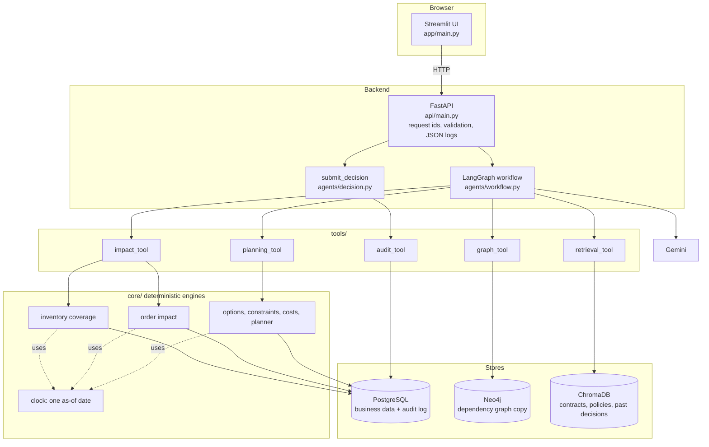
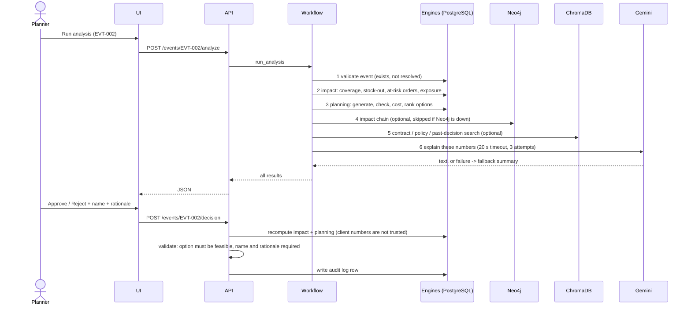

# Architecture

Everything here describes the code as it is. Items that are planned but not built are listed at the end.

## The one rule

| Layer | Produces | Never does |
|---|---|---|
| Deterministic engines (`core/`) | every number: coverage, stock-out date, at-risk orders, costs, option feasibility and rank | call an LLM |
| LLM (Gemini, `agents/nodes.py`) | the written briefing | calculate, or change a number |
| Human (UI + `agents/decision.py`) | the decision | (the system never executes an action) |

## Components

## One analysis run

`POST /events/{id}/analyze` runs six steps in a straight line. Steps 1 to 3 are deterministic. Only step 1 (validation) can end the run early; the other steps are chained unconditionally. Steps 4 and 5 catch their own errors and report them in the result (Neo4j or ChromaDB being down does not break the run). Step 6 returns a labeled fallback summary if Gemini fails. **Not verified:** what steps 4 to 6 do if step 2 or 3 returns an error. The error is passed on in the response `warnings` field, but this path has no test.

## How the shortage verdict is reached

1. **Available stock** = on hand minus reserved, summed across warehouses.
2. **Daily consumption** = units needed by open production orders (via the bill of materials) divided by the days from the event's `detected_at` to the last order's end.
3. **Coverage days** = available stock / daily consumption. **Stock-out date** = as-of date + coverage days.
4. **Shortage** only if no inbound shipment arrives before the stock runs out.
5. **At-risk orders:** open production orders are visited in order of planned start. Each draws from the stock pool. Shipments whose arrival date is on or before an order's start are added to the pool first. An order is at risk if it cannot be covered, or if it starts after the stock-out date and nothing arrives in time. Linked customer orders inherit the risk.

Step 5 was wrong until the evaluation harness exposed it (shipments were ignored, which falsely flagged an order on EVT-001). See `evaluation/cases.json`.

## Recovery options

Four types are generated: use existing stock, transfer between warehouses, expedite the late shipment, and buy from an alternate supplier. Each goes through feasibility checks (for example, expediting must land before the stock-out date), then costing, then scoring. Infeasible options are returned and shown, with the reason, but never recommended. An alternate supplier that arrives after the stock-out stays feasible but is flagged PARTIAL (`fully_closes_gap = false`, `residual_gap_days`), so neither the UI nor the AI can claim it prevents the shortage. The planner also returns the list of assumptions from `core/assumptions.py`.

## Data stores

| Store | Holds | Notes |
|---|---|---|
| PostgreSQL | suppliers, parts, inventory, BOM, purchase orders, shipments, production and customer orders, events, **decision_log** | the source of truth |
| Neo4j | a graph copy of the relationships | not self-updating: rerun `scripts/load_graph.py` after data changes |
| ChromaDB | chunked synthetic documents (45 chunks) | built by `python -m retrieval.embedder` |

## Not built (planned in the original project plan)

- Demand forecasting and statistical risk models (`core/forecasting` is empty)
- A separate business-rules module (`core/rules` is empty)
- The what-if scenario simulator (dropped on purpose)
- Authentication and per-user permissions
- Tested container deployment (files exist, never run)
- Measured quality of the LLM explanation
